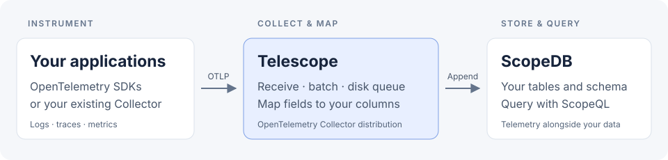

# Telescope

**OpenTelemetry in. ScopeDB tables out.**

Telescope is an OpenTelemetry Collector distribution for sending logs, traces, and metrics to ScopeDB. Keep your existing instrumentation, choose the columns you want to store, and query your telemetry with ScopeQL.



- **Use the OpenTelemetry ecosystem.** Connect an instrumented application directly, or forward data from an existing Collector.
- **Own your schema.** Select fields, preview real samples, and review table changes before applying them.
- **See what was delivered.** Disk-backed queues absorb outages; status distinguishes confirmed writes, known drops, and uncertain outcomes.

## Try it

With Go 1.27.3 installed, build Telescope and preview the bundled trace. This needs no ScopeDB connection:

```bash
git clone https://github.com/scopedb/telescope.git
cd telescope
make build
./bin/telescope preview --offline \
  --sample traces=deploy/samples/traces.otlp.json deploy/telescope.example.yaml
```

The output shows the selected columns, sample coverage, and the row that would be written. Nothing is sent yet.

**[Send your first trace →](docs/quickstart.md)** Connect a ScopeDB workspace, prepare the table, start Telescope, and verify a write.

> v0.3 is unreleased. Build from a reviewed commit; the [changelog](CHANGELOG.md) tracks the upcoming release. Existing v0.2 users should follow the [migration guide](docs/migration-v0.2.md).

## How it fits

OpenTelemetry SDKs instrument your application and export telemetry over OTLP. Telescope receives that data using the upstream Collector, then maps it into your ScopeDB tables. ScopeDB stores the rows and runs your queries. You do not need a separate Collector when your application already exports OTLP.

Have a Collector, Alloy, or another OTLP sender already? Keep it and [forward its output to Telescope](docs/integrations.md). Telescope's bundled receiver accepts OTLP; use your existing agents for file collection, scraping, filtering, or sampling.

## Guides

| I want to… | Start here |
| --- | --- |
| Get a trace into ScopeDB | [Quickstart](docs/quickstart.md) |
| Connect an SDK or existing Collector | [Integrations](docs/integrations.md) |
| Choose columns and prepare tables | [Mappings](docs/table-management.md) · [Supported fields](docs/ingestion-compatibility.md) |
| Deploy and monitor Telescope | [Deployment](docs/deployment.md) · [Operations](docs/operations.md) |
| Embed the exporter in my own distribution | [Exporter](docs/exporter.md) |

Run `telescope <command> --help` for command options. See [CONTRIBUTING.md](CONTRIBUTING.md) for the code layout, checks, and release process.

[Apache License 2.0](LICENSE)
